Computational Physics Laboratory
- Tree-Level Gluon Scattering

```wl
In[]:= (*Lanciamo un numero di kernel corrispondenti al numero di core del computer, utile per eseguire calcolo parallelo di espressioni*)
   CloseKernels[]; 
    LaunchKernels[$ProcessorCount];
```

```wl
In[]:= (*---Formattazioni dell'output---*)
   Format[mu[i_]] := Subscript[\[Mu], i]; (*indici di Lorentz*)
   Format[nu[i_]] := Subscript[\[Nu], i]; 
   Format[s[i_, j_]] := Subscript[s, i, j]; (*variabili di Mandelstam generalizzate*)
   Format[p[a_]] := Subscript[p, a]; (*impulso*)
   Format[e[a_]] := Subscript[\[Epsilon], a]; (*vettore di polarizzazione*)
   Format[c[a_]] := Subscript[c, a]; (*carica di colore*)
   Format[SP[v_, {mu_[i_]}]] := Superscript[v, mu[i]]; (*quadrivettori*)
   Format[SP[expr_ + p___, {mu_[i_]}]] := Superscript[Row[{"(", expr + p, ")"}], mu[i]]; (*quadrivettore somma*)
  (*Format[SP[n,{mu_[i_]}]]:=Superscript[n,mu[i]];*)
   Format[SP[a_, b_]] := a* b; (*prodotti scalari*)
   Format[SP[{mu[a_]}, {mu[b_]}]] := Subscript[g, mu[a], mu[b]]; (*metrica*)
   Format[SP[{nu[a_]}, {nu[b_]}]] := Subscript[g, nu[a], nu[b]]; 
   Format[SP[{mu[a_]}, {nu[b_]}]] := Subscript[g, mu[a], nu[b]]; 
   Format[delta[f_[a_], g_[b_]]] := Subscript[\[Delta], f [a], g[b]]; (*delta*)
   Format[f[f1_[a_], f2_[b_], f3_[c_]]] := Subscript[f, f1[a], f2[b], f3[c]]; (*costanti di struttura*)
   Format[T[i_]] := Superscript[T, i]; (*generatori dell'algebra*)
   Format[T[i_][ j_, k_]] := Subscript[T[i], j, k]; (*in componenti*)
   
   SetAttributes[SP, Orderless]; (*in che ordine sono messi gli indici non ha importanza*)
   SetAttributes[delta, Orderless]; 
   SetAttributes[s, Orderless]; 
   
   h = -4; (*variabile globale per enumerare gli indici sommati*)
```

### Diagrams generations

#### Graphs generation

```wl
In[]:= grafobase = {{1, -1}, {2, -1}, {3, -1}}; (*grafo iniziale*)
   
  (*Aggiunge un vertice a 3 sostituendo una linea con tre nuove*)
 inserisci3[pos_, ext_, int_, grafo_] := Module[{temp, pippo, pos1, pos2}, pos1 = grafo[[pos, 1]]; 
      pos2 = grafo[[pos, 2]]; 
      temp = ReplacePart[grafo, pippo[{ext, int}, {pos1, int}, {pos2, int}], pos]; 
      temp /. {pippo -> Sequence}]; 
   
  (*Applica inserisci3 a tutte le linee del grafo*)
 inserzione3[grafo_] := Module[{nuovigrafi, indici, npt, nvert}, indici = Flatten[grafo]; 
      npt = Max[indici]; 
      nvert = Min[indici]; 
      nuovigrafi = Table[inserisci3[i, npt + 1, nvert - 1, grafo], {i, 1, Length[grafo]}]; 
      Return[nuovigrafi]]; 
   
  (*Aggiunge un punto esterno a un vertice a 3*)
 inserisci4[vertice_, ext_, grafo_] := If[Count[grafo, vertice, Infinity] === 3, Append[grafo, {ext, vertice}], {}]; 
   
  (*Applica inserisci4 a tutti i vertici del grafo*)
 inserzione4[grafo_] := Module[{nuovigrafi, npt, nvert, indici}, indici = Flatten[grafo]; 
      npt = Max[indici]; 
      nvert = Min[indici]; 
      nuovigrafi = Table[inserisci4[i, npt + 1, grafo], {i, -1, nvert, -1}]; 
      Return[nuovigrafi]]; 
   
  (*Costruisce iterativamente tutti i grafi fino a n punti esterni*)
 generagrafi[n_, grafo_] := Module[{temp, listagrafi, nuovigrafi3, nuovigrafi4, indici}, indici = Flatten[grafo]; 
      j = Max[indici]; 
      listagrafi = {grafo}; 
      While[j < n, nuovigrafi3 = Flatten[Map[inserzione3, listagrafi], 1]; 
       nuovigrafi4 = Flatten[Map[inserzione4, listagrafi], 1]; 
       listagrafi = DeleteCases[Join[nuovigrafi3, nuovigrafi4], {}]; 
       j = j + 1;]; 
      Return[listagrafi]]; 
   
  (*---Generazione di tutti i grafi possibili con 4 e 5 linee esterne---*)
 generagrafi[4, grafobase]
 generagrafi[5, grafobase]
```

```wl
Out[]= {{{4, -2}, {1, -2}, {-1, -2}, {2, -1}, {3, -1}}, {{1, -1}, {4, -2}, {2, -2}, {-1, -2}, {3, -1}}, {{1, -1}, {2, -1}, {4, -2}, {3, -2}, {-1, -2}}, {{1, -1}, {2, -1}, {3, -1}, {4, -1}}}
```

```wl
Out[]= {{{5, -3}, {4, -3}, {-2, -3}, {1, -2}, {-1, -2}, {2, -1}, {3, -1}}, {{4, -2}, {5, -3}, {1, -3}, {-2, -3}, {-1, -2}, {2, -1}, {3, -1}}, {{4, -2}, {1, -2}, {5, -3}, {-1, -3}, {-2, -3}, {2, -1}, {3, -1}}, {{4, -2}, {1, -2}, {-1, -2}, {5, -3}, {2, -3}, {-1, -3}, {3, -1}}, {{4, -2}, {1, -2}, {-1, -2}, {2, -1}, {5, -3}, {3, -3}, {-1, -3}}, {{5, -3}, {1, -3}, {-1, -3}, {4, -2}, {2, -2}, {-1, -2}, {3, -1}}, {{1, -1}, {5, -3}, {4, -3}, {-2, -3}, {2, -2}, {-1, -2}, {3, -1}}, {{1, -1}, {4, -2}, {5, -3}, {2, -3}, {-2, -3}, {-1, -2}, {3, -1}}, {{1, -1}, {4, -2}, {2, -2}, {5, -3}, {-1, -3}, {-2, -3}, {3, -1}}, {{1, -1}, {4, -2}, {2, -2}, {-1, -2}, {5, -3}, {3, -3}, {-1, -3}}, {{5, -3}, {1, -3}, {-1, -3}, {2, -1}, {4, -2}, {3, -2}, {-1, -2}}, {{1, -1}, {5, -3}, {2, -3}, {-1, -3}, {4, -2}, {3, -2}, {-1, -2}}, {{1, -1}, {2, -1}, {5, -3}, {4, -3}, {-2, -3}, {3, -2}, {-1, -2}}, {{1, -1}, {2, -1}, {4, -2}, {5, -3}, {3, -3}, {-2, -3}, {-1, -2}}, {{1, -1}, {2, -1}, {4, -2}, {3, -2}, {5, -3}, {-1, -3}, {-2, -3}}, {{5, -2}, {1, -2}, {-1, -2}, {2, -1}, {3, -1}, {4, -1}}, {{1, -1}, {5, -2}, {2, -2}, {-1, -2}, {3, -1}, {4, -1}}, {{1, -1}, {2, -1}, {5, -2}, {3, -2}, {-1, -2}, {4, -1}}, {{1, -1}, {2, -1}, {3, -1}, {5, -2}, {4, -2}, {-1, -2}}, {{4, -2}, {1, -2}, {-1, -2}, {2, -1}, {3, -1}, {5, -1}}, {{4, -2}, {1, -2}, {-1, -2}, {2, -1}, {3, -1}, {5, -2}}, {{1, -1}, {4, -2}, {2, -2}, {-1, -2}, {3, -1}, {5, -1}}, {{1, -1}, {4, -2}, {2, -2}, {-1, -2}, {3, -1}, {5, -2}}, {{1, -1}, {2, -1}, {4, -2}, {3, -2}, {-1, -2}, {5, -1}}, {{1, -1}, {2, -1}, {4, -2}, {3, -2}, {-1, -2}, {5, -2}}}
```

```wl
In[]:= (*Calcolo del numero di grafi per ciascun numero di punti esterni*)next = Range[4, 9]; 
   ngrafi = Table[Length[generagrafi[i, grafobase]], {i, next}]; 
   
  (*Tabella riassuntiva*) 
   Grid[Prepend[Transpose[{next, ngrafi}], {"Punti esterni", "Numero grafi"}], Frame -> All, Background -> {None, {{LightGray}}}, Alignment -> Left] 
   
  (*Preparo i dati per il fit*) 
   data = Transpose[{next, ngrafi}]; 
   xVals = next; 
   yVals = ngrafi; 
   logYVals = Log[yVals]; 
   
  (*Fit lineare:log(y)=log(a)+b x=>y=a Exp[b x]*) 
   logFit = LinearModelFit[Transpose[{xVals, logYVals}], x, x]; 
   
  (*Ricavo i parametri esponenziali*) 
   bFitted = logFit["BestFitParameters"][[2]]; 
   aFitted = Exp[logFit["BestFitParameters"][[1]]]; 
   
  (*Plot con funzione di fit e R^2*) 
   Show[ListPlot[data, PlotStyle -> {Red, PointSize[Medium]}, PlotMarkers -> Automatic, Frame -> True, FrameLabel -> {"Punti esterni", "Numero grafi"}, GridLines -> Automatic, ScalingFunctions -> {"Linear", "Log"}, PlotRange -> All], Plot[aFitted Exp[bFitted x], {x, Min[xVals], Max[xVals]}, PlotStyle -> Blue, ScalingFunctions -> {"Linear", "Log"}], Epilog -> {Inset[Column[{Style["y = " <> ToString[NumberForm[aFitted, {10, 4}]] <> "\[CenterDot]e^(" <> ToString[NumberForm[bFitted, {3, 2}]] <>"\[CenterDot]x)", Medium, Black], Style["R² = " <> ToString[NumberForm[logFit["RSquared"], {3, 3}]],Medium, Black]}], Scaled[{0.5, 0.2}]]}, PlotLabel -> Style["Numero grafi con l'aumentare dei punti esterni", Small, Bold]] 
   
  (*Stampa R^2 separatamente,opzionale*) 
   Print["R² = ", logFit["RSquared"]]; 
   
  (*Pulizia finale*) 
   Clear[next, ngrafi, data, aFitted, bFitted, logFit];
```

| Punti esterni | Numero grafi |
| - | - |
| 4 | 4 |
| 5 | 25 |
| 6 | 220 |
| 7 | 2485 |
| 8 | 34300 |
| 9 | 559405 |

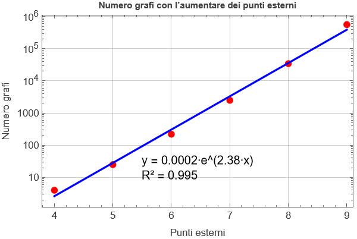

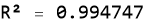

#### Field theory implementation

```wl
In[]:= (*Restituisce la lista degli impulsi associati alle linee del grafo*)listaimpulsi[grafo_] := Map[Apply[p, #] &, grafo] 
   
  (*Sostituisce {i,j} con p[i,j] nel primo elemento di ogni coppia*)
   applicaimpulsi[grafo_] := MapAt[Apply[p, #] &, grafo, {All, 1}] 
   
  (*Genera le equazioni di conservazione del momento per ogni vertice*)
   generaequazioni[grafo_] := Module[{temp}, indici = Flatten[grafo]; 
      npt = Max[indici];(*numero di punti esterni*)nvert = Min[indici];(*numero di vertici*)impulsi = listaimpulsi[grafo]; 
     (*Conservazione del momento per ciascun vertice*) equazioni = Table[impulsivertice = Join[Cases[impulsi, p[_, i]], -Cases[impulsi, p[i, _]]]; 
        eq = Apply[Plus, impulsivertice] == 0, {i, -1, nvert, -1}]; 
     (*Rinomina p[i,j]->p[i] se i>0*) equazioni = equazioni /. p[i_ /; i > 0, j_] :> p[i]; 
     (*Impulsi interni=p[i,j] non rinominati*) incognite = Cases[equazioni, p[_, _], Infinity]; 
     (*Conservazione globale:p_n=-\[CapitalSigma]p_i*) globale = Rule[p[npt], -Sum[p[k], {k, 1, npt - 1}]]; 
      equazioni = equazioni /. globale; 
      impulsiinterni = Solve[equazioni, incognite]; 
      Return[impulsiinterni]]; 
   
  (*Aggiunge indici di Lorentz e colore a ciascuna linea*)
   addIndices[grafo_] := Module[{newgrafo}, newgrafo = Table[{grafo[[i]], mu[grafo[[i, 1]]], c[grafo[[i, 1]]], If[grafo[[i, 1]] < 0, Sequence @@ {mu[grafo[[i, 2]]], c[grafo[[i, 2]]]}, Nothing]}, {i, 1, Length[grafo]}]]; 
   
  (*Costruisce l'espressione associata a un grafo*)
   diagramma[grafo_] := Module[{numeriinterni, newgrafo}, newgrafo = addIndices[grafo]; 
      regole = generaequazioni[grafo]; 
     (*Linee interne del grafo*) interne = Cases[newgrafo, {{i_ /; i < 0, j_ /; j < 0}, ___}]; 
      numeriinterni = applicaimpulsi[interne] /. regole[[1]]; 
      propagatori = Apply[Times, Map[Prop, numeriinterni]]; 
     (*Vertici:calcolo momento+indici per ciascun vertice*) vertici = Table[linee = applicaimpulsi[newgrafo]; 
        lineevertice = Join[Cases[linee, {p[a_, i], rest___} :> {p[a, i], rest}], Cases[linee, {p[i, b_], rest___} :> {-p[i, b], rest}]]; 
        lineevertice = lineevertice /. regole[[1]]; 
        lineevertice = lineevertice /. {p[i_ /; i > 0, j_], rest___} :> {p[i], rest}; 
        lineevertice = lineevertice /. {momentum___, mu[j_], c[j_], mu[k_], c[k_]} :> If[j === i, {momentum, mu[If[k > 0, k, {k, i}]], c[If[k > 0, k, {k, i}]]}, {momentum, mu[{j, i}], c[{j, i}]}];
        vertice = If[Length[lineevertice] === 3, V3[i][lineevertice], V4[i][lineevertice]]; 
        vertice, {i, -1, nvert, -1}]; 
      vertici = Apply[Times, vertici]; 
      Return[propagatori*vertici]]; 
   
  (*Genera tutti i diagrammi con n linee esterne*)
   generadiagrammi[n_, grafo_] := Module[{temp}, grafi = generagrafi[n, grafo]; 
      diagrammi = Map[diagramma, grafi]; 
      Return[diagrammi]]; 
   
  (*Esegui:aggiunta indici+generazione diagrammi*)
   addIndices /@ generagrafi[4, grafobase] 
   generadiagrammi[4, grafobase] 
   
  (*Nota:se una linea collega due punti interni,il suo indice è {interno,vertice}.Questo aiuta a distinguere contrazioni interne vs esterne nel calcolo simbolico.*)
```

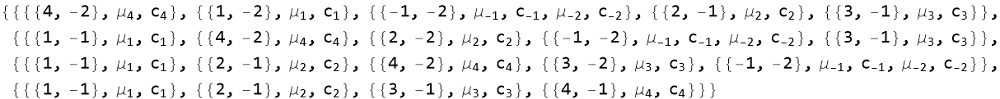

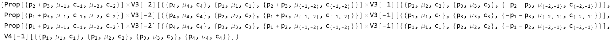

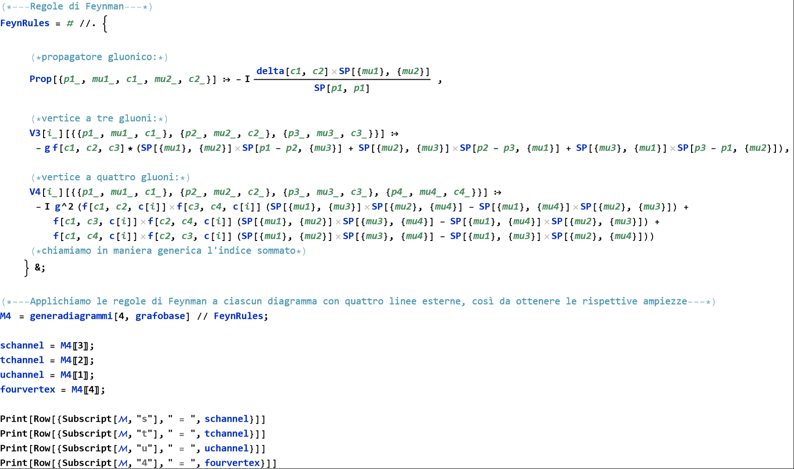

|  |  |  |
| - | - | - |
| -Subscript- |  =  | -Times- |

|  |  |  |
| - | - | - |
| -Subscript- |  =  | -Times- |

|  |  |  |
| - | - | - |
| -Subscript- |  =  | -Times- |

|  |  |  |
| - | - | - |
| -Subscript- |  =  | -Times- |

```wl
In[]:= (*---Definiamo delle regole per effettuare prodotti scalari tra strutture di colore e di Lorentz---*)
   
  (*---Prodotti psedoscalari---*)
   LorentzSP = #  //. {
         SP[a_, {mu_}] SP[b_, {mu_}] :> SP[a, b], 
         SP[a_, {mu_}] SP[a_, {mu_}] :> SP[a, a], 
         SP[{mu_}, {mu_}] :> 4, (*traccia della metrica*)
         SP[n, n] :> 0, (*gauge condition*)
         SP[p[a_], p[a_]] :> 0, (*i gluoni sono particelle massless*)
         SP[p[a_], e[a_]] :> 0  (*polarizzazioni trasverse*) 
        } &; 
    
   (*---Prodotti pseudoscalari tra punti interni---*) 
    LorentzSPinternal = # //. {
         SP[{mu[i_]}, {mu[j_]}] SP[a_, {mu[{i_, j_}]}] SP[b_, {mu[{j_, i_}]}]  :> SP[a, b], 
         SP[{mu[i_]}, {mu[j_]}] SP[{mu[{i_, j_}]}, a_] :> SP[mu[j], a],
         SP[p[a_], p[a_]] :> 0 (*i gluoni sono particelle massless*) 
        } &; 
    
   (*---Linearità e omogeneità delle strutture di Lorentz---*) 
    ExpandLorentz = # //. {
         SP[c_?NumericQ*a_, b_] :> c SP[a, b], 
         SP[a_ + b_, c_] :> SP[a, c] + SP[b, c] 
        } &; 
    
   (*---Operazioni tra fattori di colore---*) 
    colourSP  = # //. {
        (*delta applicata agli indici interni*) 
         delta[c[a_], c[b_]] f[args1___] f[args2___] /; MemberQ[{args1}, c[{a, b}]] && MemberQ[{args2}, c[{b, a}]] && b < a :> Module[{replaced}, 
           replaced = f @@ ReplacePart[{args1}, FirstPosition[{args1}, c[{a, b}]] :> c[h - 1]] f @@ ReplacePart[{args2}, FirstPosition[{args2}, c[{b, a}]] :> c[h = h - 1]] ], 
        (*delta applicata a tutti gli altri casi*) 
         delta[i_, j_]*rest_ :> (rest /. i -> j), 
        (*prodotto tra due delta*) 
         delta[a_, b_] delta[a_, c_] :> delta[b, c] 
        } &;
```

```wl
In[]:= (*Analisi dei costi simbolici:per le prime ampiezze con n = 4, 5 e 6,misuriamo memoria occupata e tempo di esecuzione nei tre passaggi chiave: espansione, contrazione degli indici interni, semplificazione.*)
   
   M5 = ParallelMap[FeynRules, generadiagrammi[5, grafobase]]; 
    M6 = ParallelMap[FeynRules, generadiagrammi[6, grafobase]]; 
    M7 = ParallelMap[FeynRules, generadiagrammi[7, grafobase]]; 
    
    firstamps = {M4[[1]], M5[[1]], M6[[1]], M7[[1]]}; 
    
    Do[
     Print["=== Symbolic processing stages for the first n =",  i + 3, " amplitude ==="]; 
      startsize = ByteCount[firstamps[[i]]]; 
      ti = AbsoluteTime[]; 
      appo = firstamps[[i]] // ExpandLorentz // Expand; 
      tf = AbsoluteTime[]; 
      finalsize = ByteCount[appo]; 
      Print["Time taken to Expand: ", tf - ti, " s"]; 
      Print["Initial and final memory usage: ", startsize, " B -> ", finalsize, " B"]; 
     (*startsize=finalsize;
     ti=AbsoluteTime[];
     appo=appo//colourSP;
     tf=AbsoluteTime[];
     finalsize=ByteCount[appo];
     Print[Time taken to colourSP: ,tf-ti, s];
     Print[Initial and final memory usage: ,startsize,B -> ,finalsize, B];*) 
      startsize = finalsize; 
      ti = AbsoluteTime[]; 
      appo = appo // LorentzSPinternal; 
      tf = AbsoluteTime[]; 
      finalsize = ByteCount[appo]; 
      Print["Time taken to contract internal indices: ", tf - ti, " s"];
      Print["Initial and final memory usage: ", startsize, " B -> ", finalsize, " B"]; 
      startsize = finalsize; 
      ti = AbsoluteTime[]; 
      appo = appo // Simplify; 
      tf = AbsoluteTime[]; 
      finalsize = ByteCount[appo]; 
      Print["Time taken to simplify the expression: ", tf - ti, " s"]; 
      Print["Initial and final memory usage: ", startsize, " B -> ", finalsize, " B"] 
     , {i, 1, Length[firstamps]}] 
    
    Clear[appo, startsize, finalsize, tf, ti]
```

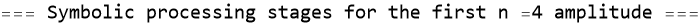

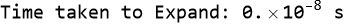

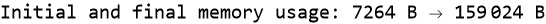

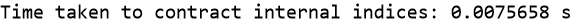

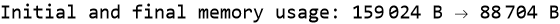

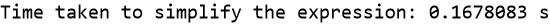


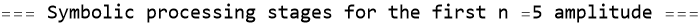

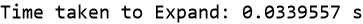

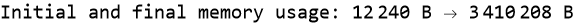

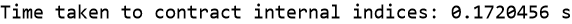

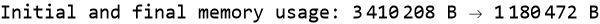

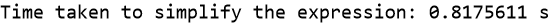

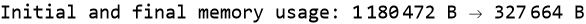

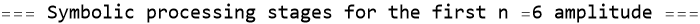

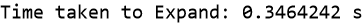

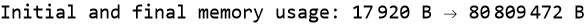

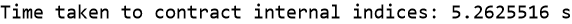

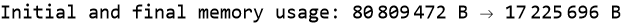

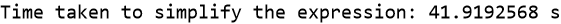


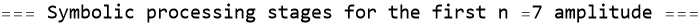

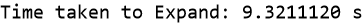

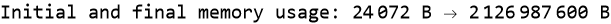

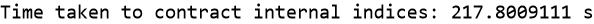

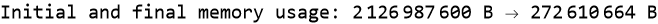

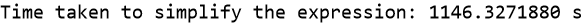

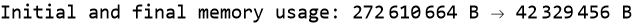

### Ward identity

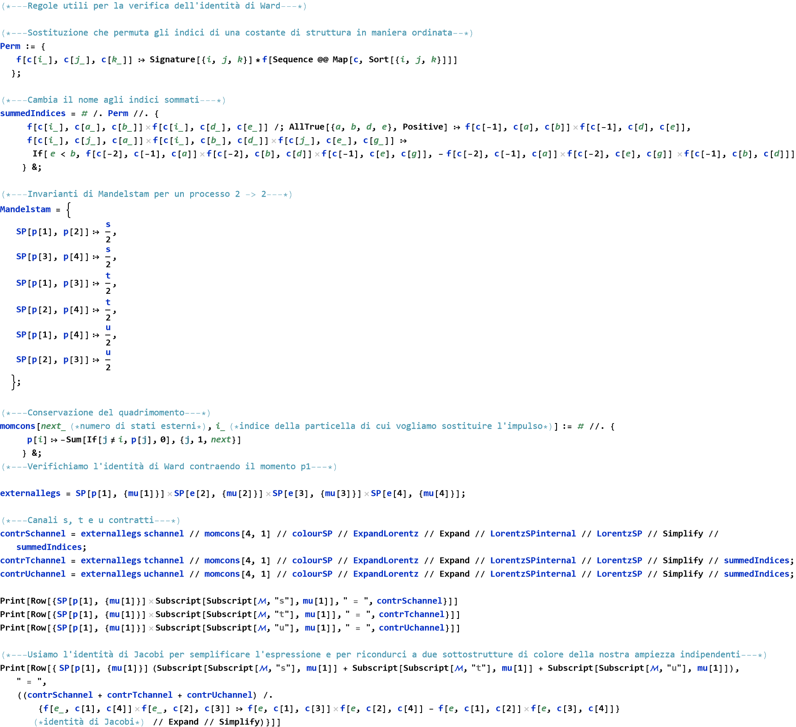

|  |  |  |
| - | - | - |
| -Times- |  =  | -Times- |

|  |  |  |
| - | - | - |
| -Times- |  =  | -Times- |

|  |  |  |
| - | - | - |
| -Times- |  =  | -Times- |

|  |  |  |
| - | - | - |
| -Times- |  =  | -Times- |

```wl
In[]:= Print[Row[{ SP[p[1], {mu[1]}] Subscript[Subscript[\[ScriptCapitalM], "4"], mu[1]], " = ", (externallegs fourvertex // momcons[4, 1] // colourSP // summedIndices // ExpandLorentz // Expand // LorentzSP) /. {f[e_, c[1], c[4]] f[e_, c[2], c[3]] :> f[e, c[1], c[3]] f[e, c[2], c[4]] - f[e, c[1], c[2]] f[e, c[3], c[4]]} // Simplify}]]
```

|  |  |  |
| - | - | - |
| -Times- |  =  | -Times- |

```wl
In[]:= (*E' facile vedere che le due espressioni si bilanciano perfettamente, essendo una l'opposto dell'altra. E' possibile verificare la identità di Ward anche per nel caso di due momenti p1 e p2 contratti*)
   
   Clear[externallegs]; 
    externallegs = SP[p[1], {mu[1]}] SP[p[2], {mu[2]}] SP[e[3], {mu[3]}] SP[e[4], {mu[4]}]; 
   (*facciamolo un po' più a forza bruta questa volta*) 
    (externallegs (schannel + tchannel + uchannel + fourvertex) // momcons[4, 1] // colourSP // summedIndices // ExpandLorentz // Expand // LorentzSPinternal // LorentzSP) /. {f[e_, c[1], c[4]] f[e_, c[2], c[3]] :> f[e, c[1], c[3]] f[e, c[2], c[4]] - f[e, c[1], c[2]] f[e, c[3], c[4]]} // Simplify
```

```wl
Out[]= 0
```

##### Color factors decomposition 

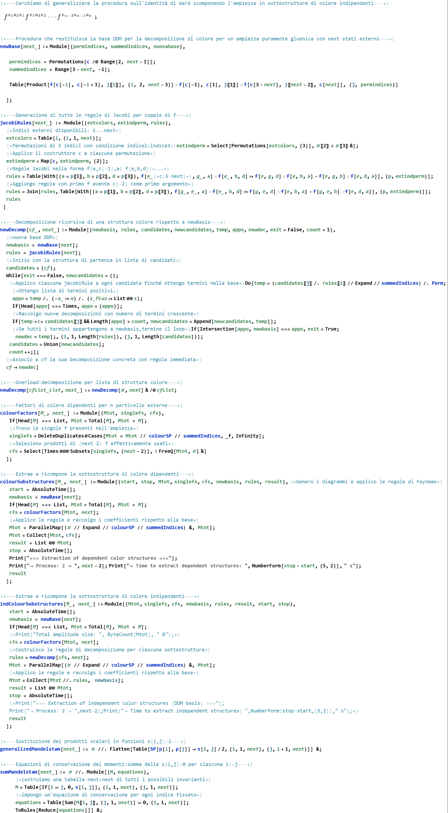

```wl
In[]:= (*---Procedura generale che verifica che le (n-2)! sottostrutture di colore siano tra loro tutto gauge invarianti---*)
   WardIdentity[next_ (*numero di stati di polarizzazione esterni*), mom___ (*momenti da contrarre*)] := Module[{start, stop, M (*contributi all'ampiezza*), colorSubstruct (*sottostrutture di colore indipendenti*), momlist (*lista dei momenti*), momindices (*indici dei momenti da contrarre*), extlegs (*gambe esterne*), result, ti, tf}, start = AbsoluteTime[]; 
       Print["=== Ward Identity Check ==="]; 
       Print["-> Process: 2 -> ", ToString[next - 2]]; 
       momlist = {mom} (*lista dei momenti da contrarre*); 
       momindices = momlist /. {p[i_] :> i} (*indici dei momenti da contrarre*); 
       If[! SubsetQ[Range[next], momindices], MessageDialog["Error: some momenta do not correspond to external legs." <> "Valid range: p[1] to p[" <> ToString[next] <> "]."]; 
        Return[$Failed];]; 
       If[AnyTrue[Tally[momindices], #[[2]] > 1 &], MessageDialog["Error: duplicate momenta detected in contraction list."]; 
        Return[$Failed];]; 
       M = ParallelMap[(# // FeynRules) &, generadiagrammi[next, grafobase]];
       ti = AbsoluteTime[]; 
       M = ParallelMap[(# // ExpandLorentz // Expand // LorentzSPinternal) &, M]; 
       tf = AbsoluteTime[]; 
       Print["Time taken to expand and do internal contractions: ", tf - ti, " s"]; 
       Print["Memory usage after expantion and internal contractions: ", ByteCount[M], " B"]; 
       ti = AbsoluteTime[]; 
       colorSubstruct = indColourSubstructures[M, next]; 
       tf = AbsoluteTime[]; 
       Print["Time taken to extract the indipendent colour sub-amplitudes: ",tf - ti, " s"]; 
       ti = AbsoluteTime[]; 
       extlegs = Product[SP[p[i], {mu[i]}], {i, momindices}]; 
       Do[If[! MemberQ[momindices, i], extlegs = SP[e[i], {mu[i]}] extlegs], {i, 1, next}]; 
       result = ParallelMap[(# // momcons[next, momindices[[1]]] // ExpandLorentz // Expand // LorentzSP) &, extlegs colorSubstruct]; 
       tf = AbsoluteTime[]; 
       Print["Time taken to do external contractions after imposing momentum conservation: ", tf - ti, " s"]; 
       ti = AbsoluteTime[]; 
       Print["Memory usage before finale internal contractions: ", ByteCount[result], " B"]; 
       result = ParallelMap[(# // generalizedMandelstam[next] // sumMandelstam[next] // Simplify) &, result]; 
       tf = AbsoluteTime[]; 
       Print["Time taken to do the final simplification after imposing Maldestam variables conservation: ", tf - ti, " s"]; 
       stop = AbsoluteTime[]; 
       Print["Total evaluation time: ", stop - start, " s"]; 
       Print["Expected result: a list of ", ToString[Factorial[next - 2]], " zeros if the Ward identity is satisfied."]; 
       result]; 
    
    WardIdentity[4, p[1]]
```

```wl
Out[]= "=== Ward Identity Check ==="
```

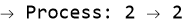

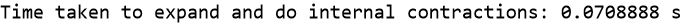


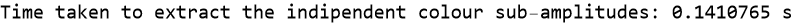

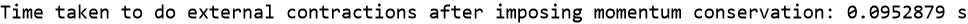


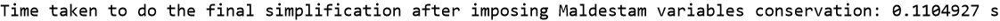

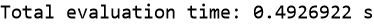


```wl
Out[]= {0, 0}
```

```wl
In[]:= WardIdentity[5, p[1]]
```

```wl
Out[]= "=== Ward Identity Check ==="
```

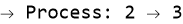

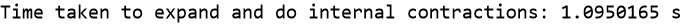


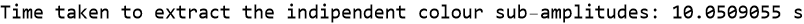

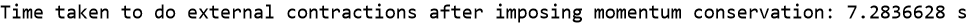

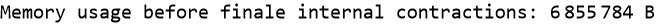

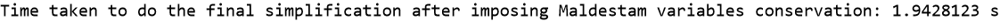


```wl
Out[]= {0, 0, 0, 0, 0, 0}
```

### Un-polarized squared amplitude

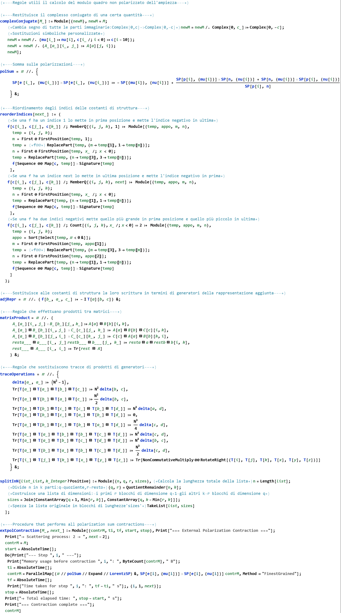

#### Independent colour sub-amplitudes

```wl
In[]:= M4 = ParallelMap[(# // ExpandLorentz // Expand // LorentzSPinternal) &, M4];
 M5 = ParallelMap[(# // ExpandLorentz // Expand // LorentzSPinternal) &, M5];
```

##### n = 4

```wl
In[]:= indcolorf4 = newBase[4]; (*base DDM*)
 ti = AbsoluteTime[];
 M4indcolorsub = indColourSubstructures[M4, 4];
 tf = AbsoluteTime[];
 Print["Time taken to extract the colour sub-amplitudes: ", tf - ti, " s"];
 M4indcolorsub = ParallelTable[Coefficient[Total[M4indcolorsub], i], {i, indcolorf4}]; (*isoliamo i solo le sottoampiezze di colore, senza le costanti di struttura*)
 extpolM4indcolorsub = extpolContraction[M4indcolorsub, 4]; (*contraiamo per la somma sulle polarizzazioni esterne*)
 M4indcolorsubDag = complexConjugate[M4indcolorsub]; (*sottoampiezze complesse coniugate*) 
  
 Print["Memory usage of contracted sub-amplitude: ", ByteCount[extpolM4indcolorsub[[1]]], " B"]; 
  
 Print["Memory usage of conjugated sub-amplitude: ", ByteCount[M4indcolorsubDag[[1]]], " B"]; 
  
 Print["Memory usage of their expanded product: ", ByteCount[extpolM4indcolorsub[[1]] M4indcolorsubDag[[1]] // Expand]," B"];
```

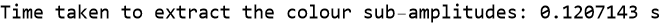

```wl
Out[]= "=== External Polarization Contraction ==="
```

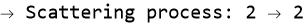


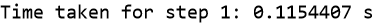


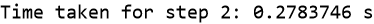


```wl
Out[]= "=== Contraction complete ==="
```


```wl
In[]:= indcolorf5 = newBase[5];
 ti = AbsoluteTime[];
 M5indcolorsub = indColourSubstructures[M5, 5];
 tf = AbsoluteTime[];
 Print["Time taken to extract the colour sub-amplitudes: ", tf - ti, " s"];
 M5indcolorsub = ParallelTable[Coefficient[Total[M5indcolorsub], i], {i, indcolorf5}];
 extpolM5indcolorsub = extpolContraction[M5indcolorsub, 5];
 M5indcolorsubDag = complexConjugate[M5indcolorsub]; 
  
 Print["Memory usage of contracted sub-amplitude: ", ByteCount[extpolM5indcolorsub[[1]]], " B"]; 
  
 Print["Memory usage of conjugated sub-amplitude: ", ByteCount[M5indcolorsubDag[[1]]], " B"]; 
  
 appo1 = splitInN[List @@ M5indcolorsub[[1]], 4][[1]];
 appo2 = splitInN[List @@ extpolM5indcolorsub[[1]], 4][[1]]; 
  
 Print["Memory usage of their expanded product: ", ByteCount[Total[appo1] Total[appo2] // Expand], " B"]; 
  
 Clear[appo1, appo2];
```


```wl
Out[]= "=== External Polarization Contraction ==="
```


```wl
Out[]= "=== Contraction complete ==="
```


#### Dependent colour sub-amplitudes

##### n = 4

```wl
In[]:= depcolorf4 = colourFactors[M4, 4]; 
 ti = AbsoluteTime[];
 M4depcolorsub = colourSubstructures[M4, 4]; (*sottoampiezze dipendenti*)
 tf = AbsoluteTime[];
 Print["Time taken to extract the colour sub-amplitudes: ", tf - ti, " s"];
 M4depcolorsub = ParallelTable[Coefficient[Total[M4depcolorsub], i], {i, depcolorf4}];
 extpolM4depcolorsub = extpolContraction[M4depcolorsub, 4];
 M4depcolorsubDag = complexConjugate[M4depcolorsub]; 
  
 Print["Memory usage of contracted sub-amplitude: ", ByteCount[extpolM4depcolorsub[[1]]], " B"]; 
  
 Print["Memory usage of conjugated sub-amplitude: ", ByteCount[M4depcolorsubDag[[1]]], " B"]; 
  
 Print["Memory usage of their expanded product: ", ByteCount[extpolM4depcolorsub[[1]] M4depcolorsubDag[[1]] // Expand]," B"];
```

```wl
Out[]= "=== Extraction of dependent color structures ==="
```


```wl
Out[]= "=== External Polarization Contraction ==="
```


```wl
Out[]= "=== Contraction complete ==="
```


##### n = 5

```wl
In[]:= depcolorf5 = colourFactors[M5, 5];
 ti = AbsoluteTime[];
 M5depcolorsub = colourSubstructures[M5, 5];
 tf = AbsoluteTime[];
 Print["Time taken to extract the colour sub-amplitudes: ", tf - ti, " s"];
 M5depcolorsub = ParallelTable[Coefficient[Total[M5depcolorsub], i], {i, depcolorf5}];
 extpolM5depcolorsub = extpolContraction[M5depcolorsub, 5];
 M5depcolorsubDag = complexConjugate[M5depcolorsub]; 
  
 Print["Memory usage of contracted sub-amplitude: ", ByteCount[extpolM5depcolorsub[[1]]], " B"]; 
  
 Print["Memory usage of conjugated sub-amplitude: ", ByteCount[M5depcolorsubDag[[1]]], " B"]; 
  
 Print["Memory usage of their expanded product: ", ByteCount[extpolM5depcolorsub[[1]] M5depcolorsubDag[[1]] // Expand]," B"];
```

```wl
Out[]= "=== Extraction of dependent color structures ==="
```


```wl
Out[]= "=== External Polarization Contraction ==="
```


```wl
Out[]= "=== Contraction complete ==="
```


```wl
Out[]= "Computation unpolarized squared amplitude for 2 -> 2 using dependent colour sub-amplitudes..."
```

```wl
Out[]= "=== Extraction of dependent color structures ==="
```


```wl
Out[]= "=== External Polarization Contraction ==="
```


```wl
Out[]= "=== Contraction complete ==="
```


```wl
In[]:= (result4 - theory4)
```

```wl
Out[]= 0
```

#### gg -> ggg

```wl
In[]:= result5 = UnpolSquaredAmplitude[5];
```

```wl
Out[]= "Computation unpolarized squared amplitude for 2 -> 3 using dependent colour sub-amplitudes..."
```

```wl
Out[]= "=== Extraction of dependent color structures ==="
```


```wl
Out[]= "=== External Polarization Contraction ==="
```


```wl
Out[]= "=== Contraction complete ==="
```


```wl
In[]:= result5
```


```wl
In[]:= result5 - theory5
```

```wl
Out[]= 0
```